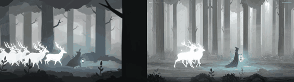

# Fog Shepherd

**[Play Fog Shepherd on GitHub Pages](https://nvc1406.github.io/FogShepherd/)**

Original game by [Lovis Odin](https://github.com/lovisdotio). [Upstream source](https://github.com/lovisdotio/video-to-game/tree/main/gallery/fog-shepherd) · [Original demo](https://fal-video-to-game.vercel.app/A07_FOG-SHEPHERD/).

**Video prompt** (MiniMax H3 Max, `minimax/h3-max/text-to-video`):

> A cloaked figure with a lantern guides a herd of glowing white deer through a monochrome foggy forest; only the circle of lantern light has color.

**Controls:** ← → walk · ↑ ↓ wander into the fog to find the deer · Space / E raise the lantern (calls the herd, scares the spirits) · Enter start · M sound

**Assets generated on fal:** 31 images, 4 3D models, 9 sounds and music,
30 calls, 5.04 USD.

| Endpoint | Calls |
|---|---|
| `fal-ai/nano-banana-pro/edit` | 12 |
| `fal-ai/elevenlabs/sound-effects/v2` | 8 |
| `fal-ai/nano-banana-pro` | 5 |
| `tripo3d/h3.1/image-to-3d` | 4 |
| `elevenlabs/music/v2.5` | 1 |

**Code:** [docs/index.html](docs/index.html), written by Claude Opus 5.5 with Three.js. This GitHub Pages copy includes the game assets served by the original demo. Three.js loads from jsDelivr.
